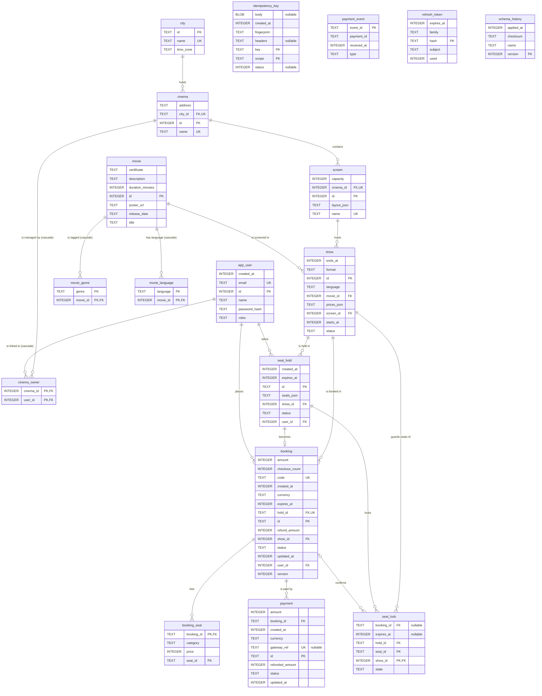

# Entity relationship diagram

The database model of BookMyShow on Jolt, as the migrations in `src/main/resources/db/migrations` (V1 to V5) produce it. The diagram is checked against the live schema on every build by `ErdDriftTest`, so it cannot silently go stale; see [How to update this file](#how-to-update-this-file). The behaviour on top of these tables is in [SPEC.md](SPEC.md) (section 3 domain model, section 4 booking lifecycle, section 6 schema).

Reading the diagram: `PK` primary key, `FK` foreign key, `UK` takes part in a UNIQUE constraint, `"nullable"` the column may be NULL. Columns are listed alphabetically. A composite key marks every member column, and a `%% unique table (a, b)` line (invisible when rendered) names a multi-column UNIQUE index. Relationship ends: `||` exactly one, `|o` zero or one, `o{` zero or many, `o|` zero or one (the child side of a one-to-one link).



Not drawn, because the schema declares no foreign key for them (they are logical references by value): `payment_event.payment_id` to `payment.id`, `refresh_token.subject` to `app_user.id` (the subject is the user id as text), and the user part of `idempotency_key.scope` (`u:<user id>`). The drift test rejects a relationship line that has no real FOREIGN KEY behind it.

## Conventions that apply to every table

- Every table is `STRICT`, so a column accepts only its declared type.
- Money is an `INTEGER` count of paise (`amount`, `price`, `refund_amount`, `refunded_amount`); the currency is `INR`.
- Instants are `INTEGER` epoch milliseconds (`created_at`, `updated_at`, `expires_at`, `starts_at`, `ends_at`, `received_at`, `applied_at`), always read through `Clock`. `movie.release_date` is the one calendar date, stored as ISO text.
- Structured values that are never queried by field are JSON text: `screen.layout_json`, `show.prices_json`, `seat_hold.seats_json`.
- Foreign keys are enforced (`PRAGMA foreign_keys = ON` per connection). Only the links marked cascade delete their children; every other delete of a referenced row is refused.
- Catalog rows and users have `INTEGER` rowid ids; city (slug), holds, bookings and payments have text ids.

## Catalog

| Table | Purpose | Key invariants |
|---|---|---|
| `city` | A city with its IANA time zone. `id` is a slug such as `bengaluru`. | `name` UNIQUE. |
| `cinema` | A cinema in one city. | `UNIQUE (city_id, name)`. |
| `screen` | An auditorium with its seat layout as JSON. | `UNIQUE (cinema_id, name)`; `capacity BETWEEN 1 AND 1000`. |
| `movie` | A film. | `certificate IN ('U','UA','A','S')`; `duration_minutes BETWEEN 1 AND 400`. |
| `movie_language`, `movie_genre` | The languages and genres of a movie, one row each. | Composite PK `(movie_id, language)` and `(movie_id, genre)` forbid duplicates; **ON DELETE CASCADE** from `movie`. |
| `show` | One screening of a movie on a screen. | `format IN ('2D','3D','IMAX')`; `status IN ('SCHEDULED','CANCELLED')`; indexes `show_screen_time (screen_id, starts_at)` and `show_movie_time (movie_id, starts_at)`. Non-overlap of shows on one screen is enforced by the use case, not by SQL. |

## Seating and booking

| Table | Purpose | Key invariants |
|---|---|---|
| `seat_hold` | A user's temporary claim on seats for a show (`seats_json`). | `status IN ('ACTIVE','CONSUMED','RELEASED','EXPIRED')`; partial index `seat_hold_active (expires_at) WHERE status = 'ACTIVE'` serves the expiry sweep. |
| `seat_lock` | One row per locked seat of a show. **The primary key `(show_id, seat_id)` is what prevents double booking**: two holds racing for one seat cannot both insert. | `state IN ('HELD','BOOKED')`; `CHECK ((state = 'HELD') = (expires_at IS NOT NULL))`, so a held seat always has an expiry and a booked seat never does; `booking_id` is set once the seat is booked; index `seat_lock_hold (hold_id)`. |
| `booking` | A purchase made from exactly one hold. | `code` UNIQUE; `hold_id` UNIQUE, so a hold becomes at most one booking (hence the one-to-one relationship); `amount > 0`; `status IN ('HELD','PAYMENT_PENDING','CONFIRMED','EXPIRED','CANCELLED','REFUNDED')`; **`version` starts at 0 and increases on every write** (optimistic concurrency); `checkout_count` is capped at 3 by the use case; indexes `booking_user (user_id, created_at DESC)` and partial `booking_open (expires_at) WHERE status IN ('HELD','PAYMENT_PENDING')`. |
| `booking_seat` | The seats of a booking with the category and price captured at hold time. | Composite PK `(booking_id, seat_id)`. |

## Payments

| Table | Purpose | Key invariants |
|---|---|---|
| `payment` | One payment attempt for a booking. | `status IN ('INITIATED','SUCCEEDED','FAILED','REFUNDED')`; `gateway_ref` UNIQUE and nullable; `CHECK (refunded_amount <= amount)`; index `payment_booking (booking_id)`. |
| `payment_event` | Gateway callbacks already processed, keyed by the gateway's `event_id`. The primary key makes a redelivered callback a no-op. | `event_id` PK. No FOREIGN KEY on `payment_id`. |

## Accounts and ownership

| Table | Purpose | Key invariants |
|---|---|---|
| `app_user` | An account. `roles` is a comma list of `AUDIENCE`, `THEATRE_OWNER`, `ADMIN`. | `email` UNIQUE, stored lowercase; roles are validated by the domain, not by SQL. |
| `cinema_owner` | Links a theatre owner to the cinemas they manage (many to many). | Composite PK `(cinema_id, user_id)`; **ON DELETE CASCADE** from both `cinema` and `app_user`; index `cinema_owner_user (user_id)` for the scope lookup. |
| `refresh_token` | Hashed refresh tokens for rotation and reuse detection. | `hash` PK; `used` flag; index `refresh_token_subject (subject)`. |

## Plumbing

| Table | Purpose | Key invariants |
|---|---|---|
| `idempotency_key` | Stored responses behind Jolt's `Idempotency` middleware: `scope` is Jolt's client scope (`u:<user id>`) and `key` the client's `Idempotency-Key`. A NULL `status` means the request is still running. | Composite PK `(scope, key)`; index `idempotency_key_created (created_at)` for the 24 hour purge. V5 replaced the V3 table (which had `user_id`, `content_type`). |
| `schema_history` | Created by `SchemaRunner`, not by a migration file: one row per applied migration with its checksum, so an edited migration is detected. | `version` PK. |

## Tables and kernel entities

| Table | Kernel type (`dev.thiru.bms.kernel`) |
|---|---|
| `city` | `catalog.City` |
| `cinema` | `catalog.Cinema` |
| `screen` | `catalog.Screen` (layout in `catalog.SeatLayout`) |
| `movie`, `movie_language`, `movie_genre` | `catalog.Movie` (languages and genres are lists inside it) |
| `show` | `catalog.Show` (prices as a map; `ShowFormat`, `ShowStatus`) |
| `seat_hold` | `booking.SeatHold` (`HoldStatus`) |
| `seat_lock` | `booking.SeatLock` |
| `booking`, `booking_seat` | `booking.Booking` (`BookingStatus`) and `booking.BookingSeat` |
| `payment` | `payment.Payment` (`PaymentStatus`) |
| `app_user` | `account.User` (`account.Role`) |
| `cinema_owner` | `account.CinemaScope` (the cinemas of one owner) |
| `payment_event`, `refresh_token`, `idempotency_key`, `schema_history` | none: infrastructure rows owned by ports and adapters |

## How to update this file

Any change to a table, column, constraint, index, migration or kernel entity MUST update this file in the same commit (AGENTS.md rule 10). `ErdDriftTest` (`src/test/java/dev/thiru/bms/docs`) migrates a fresh SQLite database with the real `SchemaRunner` and fails, listing every difference, when the diagram disagrees with it on: a table; a column or its type; PK, FK or UK markers; nullability; a multi-column UNIQUE index; a relationship, its cardinality, its verb label, or the word "cascade" on an ON DELETE CASCADE link.

1. Write the migration (a new `V<n>__*.sql`; never edit an applied one).
2. Print the expected listing from the live schema:

   ```bash
   mvn -q test -Dtest=ErdDriftTest#printExpectedErd -Derd.print=true
   ```

   It prints a Mermaid skeleton and writes it to `target/erd-expected.mmd`. Verb labels are `TODO`. Nothing overwrites this file.
3. Copy the changed entities and relationships into the `mermaid` block above and write a real verb label for each new relationship.
4. Update the prose: the table sections, the kernel mapping and the invariants. CHECK constraints, partial indexes, defaults and cascade rules are prose only, because SQLite cannot report CHECK clauses in a form the test can parse.
5. Run `mvn -B verify`; `ErdDriftTest` must be green.

What the test deliberately ignores, each with a reason (`ErdModel.IGNORED_PREFIXES` and `IGNORED_TYPES`): tables named `sqlite_*` (SQLite internals), and views, shadow and virtual tables (none exist; they hold no application data). Everything else, including `schema_history`, must be drawn.
