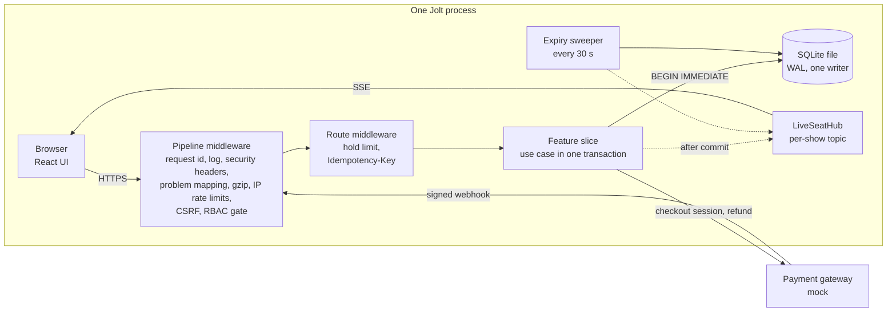
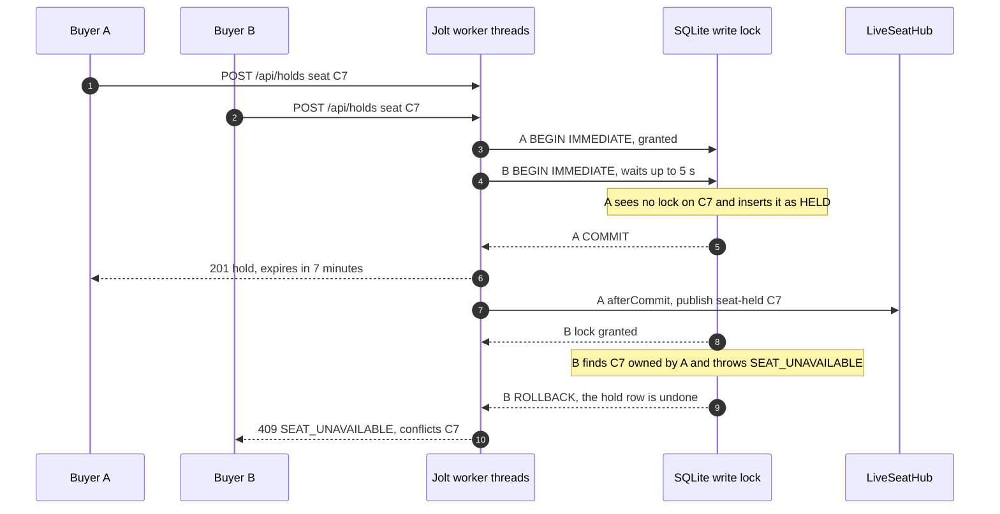
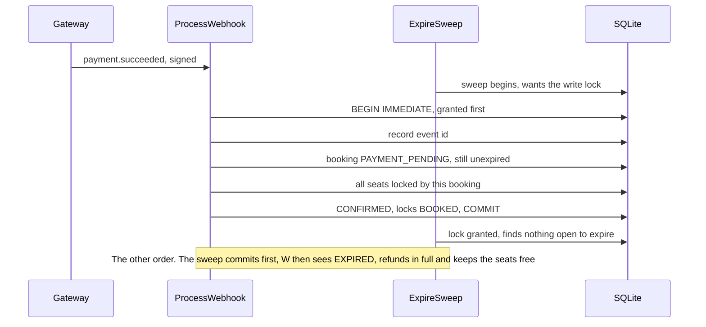
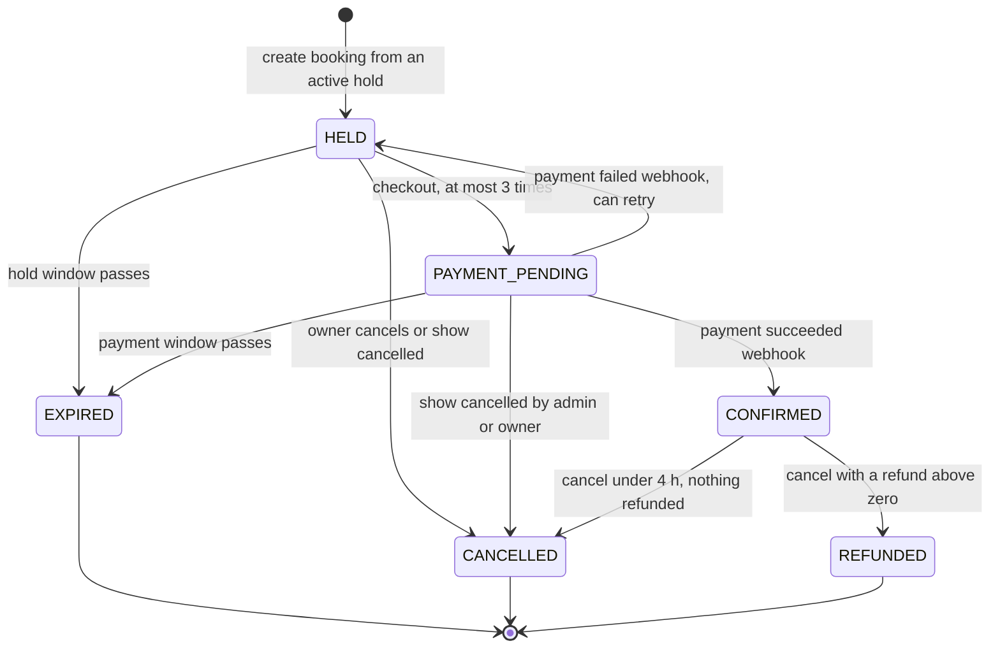
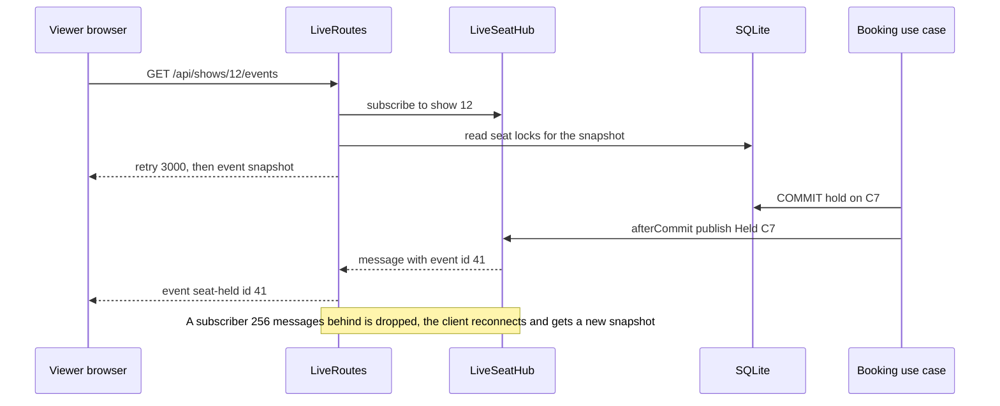

# System design: how BookMyShow on Jolt solves the classic problems

A movie ticketing service looks simple until many people want the same seat. This document lists the classic system design problems of that domain, and for each one says what goes wrong without a fix, how this code fixes it, where the fix lives, which test proves it, and where it stops working. It also lists, honestly, the popular problems this code does **not** solve.

Everything here was checked against the code at `origin/integration` and against the tests. Where a guarantee is only stated in a comment or in the spec and no test proves it, the section says so under "Trade-offs and limits". The specification is [SPEC.md](SPEC.md), the permission matrix is [RBAC.md](RBAC.md), and the restructure notes are in [restructure/](restructure/).

## Contents

1. [How the pieces fit](#how-the-pieces-fit)
2. [Pointer convention](#pointer-convention)
3. The problems: [1 double booking](#1-concurrent-double-booking-of-the-same-seat), [2 hold expiry](#2-seat-holds-with-a-time-limit), [3 payment vs expiry](#3-the-race-between-a-payment-success-and-hold-expiry), [4 idempotency and webhooks](#4-payment-idempotency-and-exactly-once-webhooks), [5 optimistic concurrency](#5-optimistic-concurrency-on-bookings), [6 state machine and refunds](#6-the-booking-state-machine-and-the-refund-policy), [7 live seat updates](#7-real-time-seat-updates-to-many-viewers), [8 catalog caching](#8-read-heavy-catalog-caching), [9 rate limiting](#9-rate-limiting-and-abuse), [10 authentication](#10-authentication), [11 authorization](#11-authorization), [12 show scheduling](#12-show-scheduling-the-screen-overlap-rule), [13 money and time](#13-money-and-time-correctness), [14 the dual-write problem](#14-the-dual-write-problem), [15 contract-first API](#15-contract-first-api), [16 graceful shutdown](#16-graceful-shutdown-with-long-lived-streams)
4. [Scenario: two people click the last seat](#scenario-two-people-click-the-last-seat-at-the-same-moment)
5. [Not solved or out of scope today](#not-solved-or-out-of-scope-today)
6. [Scaling beyond one node](#scaling-beyond-one-node)

## How the pieces fit

One Java process serves the React UI, the JSON API and the server-sent event (SSE) streams, on one SQLite file. The layering is enforced by the build: `kernel` (pure rules) and `ports` (the I/O seams) sit under six vertical `features` slices; `adapters` implement the ports; `web` is the shared HTTP kit; only `Main` names concrete adapters. See [SPEC.md](SPEC.md) section 10 and `docs/restructure/PLAN.md`.

The request path, in the order the code runs it (`web.HttpPipeline#install`, then the route table in `web.WebModules#routes`):

1. Request id, request log, security headers, problem+json mapping, gzip.
2. Per-IP rate limits on login, register and refresh; CSRF on `/api/auth`.
3. The RBAC gate on `/api`: deny by default, JWT, role checks (`web.Rbac#gate`, `web.Permissions#match`).
4. Route middleware where a route asks for it: the per-user hold limit and the `Idempotency-Key` store.
5. The slice's use case: **one** `BEGIN IMMEDIATE` transaction through `ports.Db`, plain SQL, rules from `kernel`.
6. After the commit, seat events leave through `Tx.afterCommit` to the hub, which fans them out to SSE subscribers.
7. A sweeper (`features.booking.ExpireSweep`, scheduled by `Main#scheduleSweep`) cleans up what nobody touched.

## Pointer convention

This document is machine-checked by `docs.DesignDocPointersTest`. Text in single backticks is read as a pointer when it has one of these shapes. Anything else in backticks is ordinary code and is ignored. Fenced code blocks are skipped.

| Shape | Example | The test fails when |
|---|---|---|
| Repo-relative file or directory | `src/main/resources/db/migrations/V1__schema.sql` | the path does not exist |
| Owner#member for Java | `features.booking.BookingSql#lock` | no unique class matches `Owner` (qualify it with its package tail, as `BookingOps` exists in two slices), or `member` is not declared in it |
| Owner#member for any other file | `src/main/resources/db/migrations/V1__schema.sql#seat_lock` | the word `member` does not occur in the file |
| Test pointer: Owner#member where Owner is under src/test/java | `features.booking.ConcurrentBuyersTest#noSeatIsHeldTwiceAndBookedSeatsNeverExceedCapacity` | the method is missing or has no `@Test` above it |

The test also checks that every numbered problem section has the six parts below, that each names at least one proof test, and that every Mermaid block opens with a known diagram type. Negative tests prove it fails on a missing file, a missing test method, a missing class and a helper that is not a test.

Each problem section has the same six parts: **The problem.** **Why the naive approach fails.** **The solution.** **Where it lives.** **Proof.** **Trade-offs and limits.**

Proof tests whose owner is an abstract contract class (for example `contract.DbContract`) run through the concrete test classes that extend it, named next to them.

## 1. Concurrent double booking of the same seat

**The problem.** Seat C7 is free and two buyers click it at the same instant. Exactly one of them may get it. Selling one seat twice is the failure the whole product exists to prevent.

**Why the naive approach fails.** The obvious code is "read the seat, if free then insert a booking". Under concurrency the read and the write are two steps:

1. Buyer A reads seat C7: free.
2. Buyer B reads seat C7: free.
3. A inserts a booking for C7 and takes payment.
4. B inserts a booking for C7 and takes payment.

Both checks passed because neither saw the other's write. A lock held in application memory does not help once there are two processes, and a unique check done as a query has the same read-then-write gap.

**The solution.** Two layers, and the second is the one that cannot be bypassed.

1. **Serialise writers.** Every use case runs in one SQLite `BEGIN IMMEDIATE` transaction. SQLite takes the single write lock at `BEGIN`, before the first statement, so a second buyer waits (up to the 5 s busy timeout) instead of reading a stale snapshot. Inside the transaction the check "is any requested seat already locked by another hold" is therefore exact.
2. **Make the database refuse.** The table `seat_lock` has primary key `(show_id, seat_id)` and a row exists only while the seat is held or booked. Even if some future code path skipped step 1, the second `INSERT` for the same seat fails with a constraint violation, and the code turns that into a named conflict.

A hold is all-or-nothing: if any one of the requested seats is taken, the exception rolls back the entire transaction, including the `seat_hold` row, so a failed buyer holds nothing.

**Where it lives.**

- Schema: `src/main/resources/db/migrations/V1__schema.sql#seat_lock` (primary key and the `state`/`expires_at` CHECK), `src/main/resources/db/migrations/V1__schema.sql#seat_hold`.
- The transaction: `adapters.db.SqliteDb#inTransaction` calls Jolt's `Db.inTransaction(TxMode.IMMEDIATE, ...)`; the pool and pragmas are in `adapters.db.Sqlite#open`.
- The decision: `features.booking.CreateHold#execute` and `features.booking.BookingSql#lock`. `features.booking.BookingSql#conflicts` finds the taken seats so the error can name them; the primary key is the guard that holds even if that query is skipped.
- The error: `kernel.DomainException#seatUnavailable`, mapped to 409 by `web.Problems`.

**Proof.**

- `features.booking.ConcurrentBuyersTest#noSeatIsHeldTwiceAndBookedSeatsNeverExceedCapacity`: 200 virtual-thread buyers race for overlapping seats from a pool of 12, against the real `SqliteDb` with a 16-connection pool, while the sweeper runs alongside. It asserts every request ends as exactly one winner or one `SEAT_UNAVAILABLE` naming seats inside the pool; no seat appears in two ACTIVE or CONSUMED holds; the lock table has exactly one row per winning seat; bookings never exceed the locks; and after the clock passes every expiry the sweeper leaves no ACTIVE hold and no lock.
- `adapters.db.SchemaTest#seatLockPrimaryKeyBlocksADoubleInsert`: the primary key alone rejects the second insert for the same seat and leaves one row. This proves the second layer in isolation.
- `contract.DbContract#writersAreSerialisedSoNoReadModifyWriteIsLost` (run by `adapters.db.SqliteDbContractTest`): four threads do 100 read-modify-write increments and none is lost.
- `adapters.db.SqliteTest#sliceTransactionsBeginImmediate`: a second writer is blocked from the moment a slice transaction begins, before any statement.
- `features.booking.CreateHoldTest#conflictRollsBackEverythingAndNamesTheSeats`: a hold for `A2, A3, B1` where `A3` is taken fails with `A3` named, and no partial lock, hold row or event is left.
- `features.payments.WebhookSweepRaceTest#aSuccessAndTheSweepNeverBothWin`: a confirmed seat cannot be held again by a rival (409).

**Trade-offs and limits.**

- The arbiter is the single SQLite writer lock, so all booking writes for every show queue behind one lock. That is fine for one node and a modest sale; it is the first thing to change at scale (see [Scaling beyond one node](#scaling-beyond-one-node)).
- `features.booking.BookingSql#lock` runs a conflict query before the insert. Under `BEGIN IMMEDIATE` that query is exact; under Postgres at READ COMMITTED it would not be, and the primary key (or `INSERT ... ON CONFLICT DO NOTHING`) becomes the only decider. The code is already written so that is safe.
- The test proves no seat is held twice and no partial state survives. It does not drive the primary-key path through the application (the pre-check always fires first under IMMEDIATE); that path is proven at the SQL level only.
- Comments disagree slightly: the Javadoc of `features.booking.BookingSql` says the primary key is "the only real guard", while `BookingSql#lock` says the pre-check is exact under IMMEDIATE. Both are true: IMMEDIATE makes the pre-check exact today, and the key is the backstop.

## 2. Seat holds with a time limit

**The problem.** A buyer picks seats, then wanders off. The seats must come back after a fixed time (7 minutes, `HOLD_TTL`) or a dead cart blocks a show forever. Expiry must also be correct at the exact boundary and must not depend on a background job being alive.

**Why the naive approach fails.** "A cron job deletes expired holds every minute" has three failures. Seats stay blocked until the next run. If the job is slow or down, they stay blocked indefinitely. And a buyer who tries to pay one second after expiry can still succeed if the payment path trusts the row's status instead of the clock, because the job has not run yet:

1. The hold expires at 12:07:00.
2. The job runs at 12:07:30.
3. At 12:07:10 buyer B asks for the same seat and is told it is taken, though it has been free for ten seconds.

**The solution.** Expiry is lazy first and swept second.

- **Lazy.** Every code path that cares re-checks the clock inside its own transaction. The seat map treats an expired lock as available. `CreateHold` deletes dead `HELD` locks on the seats it wants before inserting, so a seat is takeable the instant its hold expires. `CreateBooking`, `Checkout`, `CancelBooking` and the webhook compare `expires_at` with the injected `Clock` and commit the expiry (the use case returns an `Outcome` so the writes are not rolled back by the 410 error it reports).
- **Swept.** A scheduler runs `ExpireSweep` every `SWEEP_INTERVAL` (30 s) to free seats nobody touched and keep rows tidy, in batches of 500, one transaction per batch.

Paid seats never expire: the webhook flips the lock to `BOOKED` and clears `expires_at`, and the schema CHECK `(state = 'HELD') = (expires_at IS NOT NULL)` makes any other combination impossible. Checkout extends the lock and booking expiry to the payment window (`PAYMENT_WINDOW`, 5 min) so a buyer who is paying is not expired mid-payment. One active hold per user per show: a new hold atomically releases the previous one.

**Where it lives.**

- Lazy expiry on write: `features.booking.BookingSql#deleteExpiredHeld`, called from `features.booking.CreateHold#execute`; the commit-then-410 pattern is `features.booking.Outcome#fail` used by `features.booking.CreateBooking#create`.
- Lazy expiry on read: `kernel.booking.SeatLock#isLiveAt`, used by `kernel.catalog.SeatMap#assemble`.
- The window extension: `kernel.booking.Booking#startCheckout`, `features.booking.BookingSql#extendLocks`.
- The sweeper: `features.booking.ExpireSweep#run`, scheduled in `Main#scheduleSweep` on Jolt's scheduler; partial indexes `src/main/resources/db/migrations/V1__schema.sql#seat_hold_active` and `src/main/resources/db/migrations/V1__schema.sql#booking_open` make the scans cheap.
- Limits: `kernel.booking.BookingPolicy#defaults`.

**Proof.**

- `features.booking.CreateHoldTest#expiredLocksOnRequestedSeatsAreTakenOver`: after 7 minutes a second buyer takes the seat with no sweeper involved, and an `EXPIRED` release event is published.
- `features.booking.ExpireSweepTest#nothingToDoBeforeExpiry`, `features.booking.ExpireSweepTest#expiresHoldsAtTheBoundaryAndFreesSeats`: nothing happens 1 ms before the TTL; exactly at the TTL the hold becomes `EXPIRED`, the lock is freed and one `Released` event is published.
- `features.booking.ExpireSweepTest#expiresOpenBookingsButNotConfirmedOnes`, `features.booking.ExpireSweepTest#drainsMoreThanOneBatch`: open bookings expire, a confirmed one does not, a second run is a no-op, and 505 holds drain across two batches.
- `features.booking.CreateBookingTest#expiredHoldGivesGoneAndIsExpiredWithItsLocksFreed` and `features.booking.CheckoutTest#expiredBookingGivesGoneAndIsExpiredAndFreed`: the caller gets 410 and the expiry is committed, without any sweep.
- `features.booking.CheckoutTest#extendsBookingAndLockExpiryToThePaymentWindow`: expiry moves out to the payment window for both the booking and every lock.
- `kernel.catalog.SeatMapTest#liveLocksAreHeldOrBookedAndExpiredHoldsAreAvailable`: an expired hold already shows as available.
- `features.booking.CreateHoldTest#newHoldReleasesTheCallersPreviousActiveHold`: one active hold per user per show.
- `MainTest#theSweepRunsOnJoltsSchedulerOnceListeningAndStopsOnClose`: the sweep is scheduled once listening and stops on close.

**Trade-offs and limits.**

- The sweeper's row and lock cleanup is one more writer on the single SQLite lock; the tests run it alongside 200 buyers and it takes the lock only briefly.
- Between a hold's expiry and the next sweep, its `seat_hold` row is still `ACTIVE`. That is harmless because no path trusts the status without the clock, and the sweep fixes it within 30 s.
- A sweep that lags (a very large backlog) still holds the writer lock for one batch at a time; it is bounded by `ExpireSweep.BATCH`.
- At scale a hold is a Redis key with a native TTL, and the sweeper becomes a reconciliation job (see [Scaling beyond one node](#scaling-beyond-one-node)).

## 3. The race between a payment success and hold expiry

**The problem.** The buyer pays at 11:59 of a 12:00 expiry. The gateway's success webhook arrives at 12:00:05, after the booking has expired, and the sweeper may have given the seats to someone else. The customer paid and has nothing.

**Why the naive approach fails.** "On payment success, set the booking to confirmed":

1. Buyer A's booking expires at 12:00; the sweeper frees seat C7.
2. Buyer B holds C7 at 12:00:02 and is now paying.
3. A's success webhook arrives at 12:00:05 and flips A's booking to confirmed.
4. Two confirmed bookings for C7, or, if the seat lock is gone, a ticket for a seat that is not locked.

Or the opposite: the webhook confirms and the sweeper, in a separate transaction, expires the same booking a moment later.

**The solution.** The webhook never trusts status. In one transaction it:

1. Records the event id (deduplication, problem 4).
2. Re-checks expiry against the clock and expires an overdue open booking itself.
3. Confirms only if the booking is `PAYMENT_PENDING` **and** every seat is still locked for this booking and no other (`ownsAllLocks`).
4. Otherwise refunds the customer in full and leaves the booking expired (or cancelled, or already refunded).

Because the webhook and the sweeper both take the SQLite write lock, whoever commits first wins and the loser sees the winner's result: confirmed, or expired with a refund. A **late success always gives a refund**.

**Where it lives.**

- `features.payments.ProcessWebhook#process` (event record, expiry re-check, branch), `features.payments.ProcessWebhook#succeed` (confirm or refund), `features.payments.ProcessWebhook#ownsAllLocks`.
- The expiry write: `features.payments.BookingOps#expire`; lock rows: `features.payments.PaymentSql#locks`, `features.payments.PaymentSql#markBooked`.
- The refund: `ports.PaymentGateway`, mock in `adapters.payment.MockPaymentGateway#refund`.

**Proof.**

- `features.payments.WebhookSweepRaceTest#aSuccessAndTheSweepNeverBothWin`: ten rounds, a success webhook and a sweep (with a clock 8 minutes ahead) start together on virtual threads. Each round ends in exactly one consistent state. `CONFIRMED` means payment `SUCCEEDED`, no refund, and the seat cannot be held again (409). `EXPIRED` means payment `REFUNDED` in full, one gateway refund, and the seat is free again (201). Across all rounds there is one refund per expired booking and no seat locked twice.
- `features.payments.ProcessWebhookTest#successAfterExpiryExpiresTheBookingAndRefundsInFull`: a success 8 minutes late expires the booking, refunds 36000 paise and frees the seats with an `EXPIRED` event.
- `features.payments.ProcessWebhookTest#lostLocksRefundAndExpireInsteadOfConfirming` and `features.payments.ProcessWebhookTest#aLockNoLongerAttachedToTheBookingIsNotOwned`: a booking that looks live but lost its seats is refunded, not confirmed.
- `features.payments.ProcessWebhookTest#successOnACancelledBookingRefundsInFull`: a success for a cancelled booking is refunded.
- `features.payments.PaymentRoutesTest#aLateSuccessExpiresRefundsAndAnnouncesTheFreedSeats`: the same through HTTP, including the live event for the freed seats.

**Trade-offs and limits.**

- The refund is a gateway call made **inside** the write transaction. That is acceptable only for the mock gateway; with a real gateway it holds the writer lock for a network round trip and its rollback cannot undo money the provider already moved. This is ADR 0002, summarised in problem 14.
- **Late success after a failed attempt is refunded.** A success event for a payment already `FAILED` (a timeout reported as failed and settled later, or an amount-mismatch failure whose money the gateway still took) means money was captured for an attempt we had closed. `features.payments.ProcessWebhook#succeed` marks it `SUCCEEDED` then `REFUNDED` in full through the gateway, inside the transaction, and leaves the booking and its locks alone (a `HELD` booking stays retryable). A success for a payment already `SUCCEEDED` or `REFUNDED` is a no-op, so a second event id can never refund twice. An event whose amount or currency does not match is still a mismatch (422) and refunds nothing, because the amount cannot be trusted. Proof: `features.payments.ProcessWebhookTest#aLateSuccessForAFailedAttemptRefundsInFullAndLeavesTheBookingRetryable`, `features.payments.ProcessWebhookTest#aSecondSuccessEventForTheSamePaymentNeverRefundsTwice`, `features.payments.ProcessWebhookTest#redeliveringTheLateSuccessEventRefundsOnce`, `features.payments.ProcessWebhookTest#aFailingRefundOfALateSuccessRollsBackSoRedeliveryWorks`, and over HTTP `features.payments.PaymentRoutesTest#paymentFailedThenPaymentSucceededRefundsTheCustomerOverHttp`.
- Redelivery: if the refund throws, the whole transaction, including the event-id row, rolls back and the webhook answers 500, so a gateway that retries will redeliver and succeed (`features.payments.ProcessWebhookTest#failedGatewayRefundRollsBackSoTheEventCanBeRedelivered`). The redelivery is also tested over HTTP (`features.payments.PaymentRoutesTest#aFailedFirstDeliveryRollsBackAndTheRedeliveryAppliesOnceWithNoDuplicateEffects`), but the in-repo mock sender does **not** retry, so no real sender in this repo drives it.

## 4. Payment idempotency and exactly-once webhooks

**The problem.** Networks duplicate and retry. A user double-clicks Pay, a mobile client retries a timed-out request, the gateway redelivers a webhook. Each retry must have the same effect as the first, and a forged or replayed webhook must do nothing.

**Why the naive approach fails.** Without protection:

1. The client sends `POST /api/holds`; the response is lost.
2. The client retries; the server creates a second hold (replacing the first) and the user sees seats flicker.
3. The gateway sends `payment.succeeded` twice; the second delivery runs the confirm logic again, publishes a second `seat-booked`, or refunds twice.
4. An attacker who can reach `/api/payments/webhook` posts `payment.succeeded` for someone else's booking and gets a free ticket.

**The solution.** Four independent mechanisms.

- **`Idempotency-Key` on every state-changing POST.** The key is required (missing gives 400) on holds, bookings, checkout, cancel and every admin and owner POST. The first request stores its response under `(scope, key)`; a replay returns the stored bytes with `Idempotency-Replayed: true` and runs nothing. The same key with a different body is 422, a request still running is 409. The scope is the verified user (`u:<id>`), so one user's key can never replay another's response. Claiming a key happens in its own `BEGIN IMMEDIATE` transaction, so two concurrent requests with one key cannot both start. A request that fails releases its key so the client can retry. An unfinished claim older than the 2 minute lease is reclaimed by the same request. Stored keys are purged after 24 hours.
- **Event deduplication.** Every webhook carries an `eventId`, recorded in `payment_event` (primary key) with `INSERT OR IGNORE` as the first step of the transaction. A duplicate returns 200 `{"duplicate": true}` and touches nothing.
- **HMAC signature and timestamp tolerance.** The webhook is not behind the JWT gate. Its credential is `Bms-Signature: v1=<hex HMAC-SHA256(secret, timestamp + "." + rawBody)>` plus a `Bms-Timestamp` within 300 seconds of now, checked by Jolt's `Webhooks.hmacSha256` middleware **before** the body is parsed. A forged, tampered, stale or future call is 401. The timestamp bounds the replay window and the event id closes it.
- **Amount check.** The event's amount and currency must equal the payment's; a mismatch marks the payment `FAILED` and answers 422.

**Where it lives.**

- Key middleware: `web.Idempotent#required`, wired in `web.HttpPipeline#idempotent`; routes ask for it in `features.booking.BookingRoutes#register`.
- The store: `adapters.db.SqlIdempotency#begin`, `adapters.db.SqlIdempotency#complete`, `adapters.db.SqlIdempotency#release`, `adapters.db.SqlIdempotency#purgeBefore`; table `src/main/resources/db/migrations/V5__idempotency_scope.sql#idempotency_key`.
- Dedup: `features.payments.PaymentSql#recordEvent`, table `src/main/resources/db/migrations/V1__schema.sql#payment_event`.
- Signature: `web.WebModules#routes` builds the Jolt verifier with `WEBHOOK_TOLERANCE`; the mock side signs with `adapters.payment.WebhookSigner#sign`.
- Amount check: `kernel.payment.Payment#matches`, used in `features.payments.ProcessWebhook#process`.

**Proof.**

- `features.booking.BookingRoutesTest#aReplayReturnsTheStoredResponseAndADifferentBodyIs422`: a replay returns identical bytes with `Idempotency-Replayed`, echoes its own request id, creates no second hold and publishes no second event; the same key with other seats is 422 `IDEMPOTENCY`.
- `features.booking.BookingRoutesTest#holdNeedsAnIdempotencyKey` and `features.booking.BookingRoutesTest#aFailedRequestReleasesItsKey`.
- `web.RbacTest#idempotencyKeysAreScopedPerUser` and `features.admin.AdminRoutesTest#adminPostsNeedAnIdempotencyKeyAndReplay`.
- `adapters.db.SqlIdempotencyTest#firstUseStartsThenInFlightUntilCompletedThenReplays`, `adapters.db.SqlIdempotencyTest#differentRequestUnderTheSameKeyIsAMismatch`, `adapters.db.SqlIdempotencyTest#releaseForgetsAnInFlightClaimButNotAStoredResponse`, `adapters.db.SqlIdempotencyTest#purgeDropsKeysOlderThanTheCutoff`.
- `features.payments.ProcessWebhookTest#duplicateEventHasNoSideEffects`: a second delivery leaves the booking version unchanged, publishes nothing and refunds nothing.
- `features.payments.PaymentRoutesTest#successConfirmsADuplicateReplaysAndTheTicketIsServed`: the duplicate over HTTP.
- `features.payments.PaymentRoutesTest#aFailedFirstDeliveryRollsBackAndTheRedeliveryAppliesOnceWithNoDuplicateEffects`: the first delivery fails (the refund throws, answer 500, nothing recorded), the redelivery of the same event id succeeds, and a third is a duplicate; one refund, one release, one event row.
- `features.payments.PaymentRoutesTest#webhookRejectsBadSignaturesAndMismatchedAmounts`: forged signature, missing signature, tampered body, timestamp 301 s stale and 301 s in the future are all 401; exactly 300 s off still reaches validation (422); an amount of 1 paise marks the payment `FAILED`.
- `adapters.payment.WebhookSignerTest#joltsWebhookCheckAcceptsOnlyAFreshCorrectSignature`: the signer and Jolt's verifier agree, and a wrong secret or a body with one extra space is refused.
- `features.payments.ProcessWebhookTest#amountMismatchFailsThePayment` and `features.payments.ProcessWebhookTest#currencyMismatchFailsThePayment`.
- `adapters.db.SchemaTest#emailAndWebhookEventIdsAreUnique`: the event-id uniqueness is in the schema.

**Trade-offs and limits.**

- **A crash mid-request no longer wedges a key.** A killed process leaves a claim with no stored response (`status IS NULL`). That claim is a lease of 2 minutes (`adapters.db.SqlIdempotency#LEASE`, longer than any keyed request: the busy timeout is 5 s): once it is older, the next request with the same key and fingerprint takes it over, restarts the lease and runs. Before the lease ends it is still 409 with `Retry-After`; a different body is still 422; a completed response replays until the 24 h purge. The lease reuses `created_at`, so there is no schema change. Cost of the choice: a request that really runs longer than 2 minutes could be run a second time by a retry, which is why the lease is far above the longest keyed request. Proof: `contract.IdempotencyStoreContract#aStuckClaimIsReclaimedByTheSameRequestOnlyAfterTheLease`, `contract.IdempotencyStoreContract#aStuckClaimIsNeverTakenOverByADifferentRequest` and `contract.IdempotencyStoreContract#aCompletedResponseStillReplaysAfterTheLease` (run by `adapters.db.SqlIdempotencyContractTest`; Jolt's in-memory store takes no clock and keeps a claim until released, so `web.JoltIdempotencyContractTest` skips them), `adapters.db.SqlIdempotencyTest#aClaimOlderThanTheLeaseIsReclaimedByTheSameRequestOnly`, and over HTTP on the SQL store with a mutable clock `features.booking.IdempotencyLeaseRoutesTest#aStuckClaimIsReclaimedAfterTheLeaseAndTheRequestRuns`, `features.booking.IdempotencyLeaseRoutesTest#aFreshInFlightClaimStillAnswers409WithRetryAfter`, `features.booking.IdempotencyLeaseRoutesTest#aDifferentBodyOnAStuckClaimIsStill422`, `features.booking.IdempotencyLeaseRoutesTest#aCompletedResponseStillReplaysAfterTheLease`.
- The key store is SQLite, so it shares the writer lock with bookings. At scale it moves to Redis (`SET NX` with a TTL) or a Postgres table with `ON CONFLICT`.
- Retries are not generated anywhere in this repo. The mock sender posts once. Redelivery behaviour (problem 3) is therefore proven on the receiver only.
- The route order is hold limit, then idempotency, so a replay spends rate-limit budget.
- Refund calls carry no idempotency key to the gateway yet. Today that is moot (mock). With a real gateway it is required (problem 14).

## 5. Optimistic concurrency on bookings

**The problem.** Several actors can change one booking at nearly the same time: the buyer cancels, the webhook confirms, the sweeper expires. Each loads the booking, decides a transition, and writes it. The last writer must not silently overwrite a change it never saw.

**Why the naive approach fails.** Read-modify-write without a version:

1. The webhook loads the booking as `PAYMENT_PENDING`.
2. The sweeper loads the same row and expires it, committing `EXPIRED`.
3. The webhook, still holding its stale copy, writes `CONFIRMED`. The expiry is lost and the freed seats now back a confirmed booking.

**The solution.** Every booking write is `UPDATE booking SET ..., version = version + 1 WHERE id = ? AND version = ?` and must change exactly one row. A miss means someone moved the row since it was read. The code then re-reads the booking, re-applies the transition rules to the fresh state (which may now be illegal and fail properly), and tries once more. A second miss surfaces as 409 `VERSION_CONFLICT`. Transitions themselves are validated by the state machine (problem 6), so re-applying on fresh state is safe.

**Where it lives.**

- The guarded write: `features.booking.BookingSql#updateBooking` (and the payments slice's own copy, `features.payments.PaymentSql#updateBooking`).
- The one retry: `features.booking.BookingOps#apply`, `features.payments.BookingOps#apply`.
- Column and start value: `src/main/resources/db/migrations/V1__schema.sql#booking` (`version`), `kernel.booking.Booking#create`.
- The error: `kernel.DomainException#versionConflict`.

**Proof.**

- `features.booking.CheckoutTest#versionConflictIsRetriedOnceThenSurfaces`: with one injected miss the checkout still succeeds; with two it fails with `VERSION_CONFLICT`, the booking stays `HELD` and no payment row is left behind.
- `features.payments.ProcessWebhookTest#aVersionMissIsRetriedOnce`: the same for the webhook.
- `features.booking.CheckoutTest#movesToPaymentPendingAndOpensAPayment`: the version goes from 0 to 1 on a write.
- `kernel.booking.BookingTest#createStartsHeldAtVersionZeroWithHoldExpiry`.

**Trade-offs and limits.**

- **Be clear about what the tests show.** Under SQLite `BEGIN IMMEDIATE` a real conflict cannot happen: the read and the write are in one transaction that already owns the write lock, so no one can slip in between. The tests therefore **inject** a miss by wrapping the transaction; they prove the retry-once-then-409 logic, not a real race. The version column is the guard that becomes load-bearing when the database moves to Postgres at READ COMMITTED or when two processes write (see [Scaling beyond one node](#scaling-beyond-one-node)).
- The retry is deliberately one attempt: a second miss under real contention means the booking is genuinely hot and the caller should see 409.
- The cancel-show path in `features.admin.CancelShow#run` applies the same guarded write through its own copy.

## 6. The booking state machine and the refund policy

**The problem.** A booking moves through payment, confirmation, expiry and cancellation. Illegal moves (cancelling an expired booking, confirming a refunded one) must be impossible, and money returned on a cancellation must follow a fixed time-based policy.

**Why the naive approach fails.** With a free-form `status` string every handler invents its own rules. One path forgets to check that the booking is still open, another refunds a booking that was never paid, and the refund percentage is computed with floating point and drifts by a paisa.

**The solution.** The state machine is a table in the domain, enforced in one place: every transition is a method on the immutable `Booking` record, and the private `copy` refuses any move the table in `BookingStatus.next()` does not allow. The refund amount comes from one pure function of `(amount, showStart, now)`, in whole paise with integer arithmetic:

| Time to show start (t) | Refund |
|---|---|
| t > 24 h | full amount |
| 4 h <= t <= 24 h | half, rounded down |
| 0 < t < 4 h | nothing |
| t <= 0 | cancellation refused, `SHOW_STARTED` |

Owner cancellation of a `PAYMENT_PENDING` booking is refused (`PAYMENT_IN_PROGRESS`) because a payment may be in flight. Cancelling a whole show refunds every confirmed booking in full.

**Where it lives.**

- The table: `kernel.booking.BookingStatus#next`; the guard on every move: `kernel.booking.Booking#copy`.
- Transitions: `kernel.booking.Booking#startCheckout`, `kernel.booking.Booking#paymentSucceeded`, `kernel.booking.Booking#paymentFailed`, `kernel.booking.Booking#expire`, `kernel.booking.Booking#cancelByOwner`, `kernel.booking.Booking#cancelByShow`.
- The policy: `kernel.booking.RefundPolicy#refundAmount`.
- The refund call: `features.booking.CancelBooking#run`.
- Status check in the schema: `src/main/resources/db/migrations/V1__schema.sql#booking` (CHECK on `status`).

**Proof.**

- `kernel.booking.BookingTest#everyStatusActionPairFollowsTheTransitionTable`: every status crossed with every action either follows the table or is rejected.
- `kernel.booking.BookingTest#transitionTableMatchesTheSpecDiagram`.
- `kernel.booking.BookingTest#ownerCancelRefundsPerTheTimeBand` and `kernel.booking.BookingTest#showCancelRefundsConfirmedBookingsInFull`.
- `kernel.booking.BookingTest#thirdCheckoutIsAllowedFourthIsLimited` and `kernel.booking.BookingTest#expiryIsCheckedAtTheBoundary`.
- `kernel.booking.RefundPolicyTest#refundFollowsTheTimeBands`, `kernel.booking.RefundPolicyTest#halfRefundRoundsDownToThePaisa`, `kernel.booking.RefundPolicyTest#atOrAfterStartIsShowStarted`.
- `features.booking.CancelBookingTest#confirmedMoreThan24hAheadRefundsInFull`, `features.booking.CancelBookingTest#confirmedWithinTheHalfRefundBandRoundsDown`, `features.booking.CancelBookingTest#anOddAmountRoundsDown`, `features.booking.CancelBookingTest#confirmedUnderFourHoursIsCancelledWithoutRefundAndSeatsAreReleased`, `features.booking.CancelBookingTest#paymentPendingCannotBeCancelled`, `features.booking.CancelBookingTest#afterStartIsShowStartedAndNothingChanges`.
- `features.admin.CancelShowTest#refundsConfirmedCancelsOpenReleasesHoldsAndIsIdempotent`.
- `adapters.db.SchemaTest#holdBookingAndPaymentStatusChecks`: the database refuses a status outside the allowed set.

**Trade-offs and limits.**

- The refund bands are fixed constants in `RefundPolicy`; per-cinema or per-movie policies would need configuration and a stored policy version on the booking.
- A confirmed booking cancelled under 4 hours ends `CANCELLED` with `refund_amount = 0`; the payment stays `SUCCEEDED`. That is the policy, not a leak.
- The refund is a gateway call inside the transaction (problem 14); a failed refund rolls the cancellation back (`features.booking.CancelBookingTest#gatewayRefundFailureRollsBackTheCancellation`), which is correct for the mock and not for a real provider.
- The status column is checked by the database as an allowed set, but the legal transitions between statuses are enforced by the Java table, not by a trigger. Writing SQL by hand can bypass them.

## 7. Real-time seat updates to many viewers

**The problem.** Hundreds of people watch the same seat map. When someone holds or books a seat the others should see it within a moment, without each client polling and without a slow or dead client slowing down booking.

**Why the naive approach fails.**

1. **Polling.** 1000 viewers polling every 2 s is 500 requests per second of pure waste on the single writer's database file.
2. **Publishing inside the transaction.** If the event is sent before the commit and the transaction then rolls back (the hold lost a race), viewers see a seat as held that never was.
3. **Blocking fan-out.** If publish writes to each client socket inline, one stalled browser blocks the booking thread that triggered the event.
4. **Missed events.** A client that connects, reads the seat map, then subscribes misses any change in between; one that subscribes first and then reads sees an event for a state it already has.

**The solution.**

- **Fan-out through a hub.** One topic per show. Use cases publish after commit; the SSE route reads messages back. Jolt's `Hub` owns delivery.
- **Bounded per-subscriber queues, slow clients dropped.** Each subscriber has a queue of 256 (`SSE_QUEUE`). A subscriber that falls that far behind is dropped; publishing never blocks. The browser's `EventSource` reconnects (the server sends `retry: 3000`) and starts again with a fresh snapshot.
- **A cap on open streams** (`SSE_MAX_STREAMS`, 1000): one more is refused with 503.
- **Snapshot on connect.** Every connection, including a reconnect, starts with a full `snapshot` event of the seat map. A client never needs a missed event.
- **Event ids, no replay.** Each seat event carries the hub's increasing id. The server does **not** replay missed events on `Last-Event-ID` (replay is off, the snapshot replaces it).
- **Subscribe before snapshot.** The route subscribes first, then reads the snapshot. An event racing the read is delivered after the snapshot; it may already be reflected in it, which is harmless because each seat event states the seats' new status, not a delta.
- A heartbeat every 15 s keeps proxies from closing a quiet stream; the stream ends when the show starts or is cancelled.

**Where it lives.**

- Fan-out and queues: `adapters.live.LiveSeatHub#publish`, `adapters.live.LiveSeatHub#subscribe`, the per-stream hand-off in `adapters.live.LiveSeatHub#deliver`, shutdown in `adapters.live.LiveSeatHub#closeAll`; the hub is created in `Main#app` with `Main.SSE_QUEUE`.
- The route: `features.live.LiveRoutes#stream` (subscribe, then snapshot, then pump) and `features.live.LiveRoutes#pump`.
- Post-commit publishing: `ports.Db#afterCommit`, run by `adapters.db.SqliteDb#runAfterCommit`; helper `features.booking.BookingOps#publish`.
- Ports and event types: `ports.LiveSeats`, `ports.SeatEvents`, `ports.SeatEvent`.
- The snapshot's assembly (shared with the catalog's seat-map endpoint): `kernel.catalog.SeatMap#assemble`, SQL in `features.live.LiveSql#snapshot`.

**Proof.**

- `adapters.live.LiveSeatHubTest#aSubscriberThatNeverReadsIsDroppedWithoutBlockingPublishers`: 200 publishes to a subscriber that never reads finish in under a second and the subscriber is dropped.
- `contract.LiveSeatsContract#everyMessageCarriesAnEventIdThatIncreasesInPublishOrder` (run by `adapters.live.LiveSeatHubContractTest`): ids increase in publish order.
- `adapters.live.LiveSeatHubTest#subscribersOnlySeeTheirShow`, `adapters.live.LiveSeatHubTest#streamCapAndCloseAreReflectedInOpenStreams`, `adapters.live.LiveSeatHubTest#publishingWithNoSubscribersIsANoOp`, `adapters.live.LiveSeatHubTest#heldEventsBecomeSeatHeldMessages`.
- `features.live.LiveRoutesTest#streamStartsWithRetryAndSnapshotThenForwardsEventsAndHeartbeats`: `retry: 3000`, then the snapshot (with no id), then the forwarded event with its id, then a heartbeat.
- `features.live.LiveRoutesTest#unknownShowIs404AndAFullHubIs503`, `features.live.LiveRoutesTest#theStreamEndsWhenTheShowStarts`, `features.live.LiveRoutesTest#aCancelledShowGetsOnlyTheSnapshot`, `features.live.LiveRoutesTest#aStartedShowGetsOnlyTheSnapshot`.
- `features.live.SubscribeBeforeSnapshotTest#anEventPublishedBetweenSubscriptionAndSnapshotIsStillDelivered`: an event published between subscribe and snapshot is delivered.
- `features.booking.CreateHoldTest#eventsArePublishedOnlyAfterTheCommit` and `features.booking.CreateHoldTest#aFailingSubscriberDoesNotFailTheHold`: a subscriber that reads the database already sees the hold, and a throwing subscriber does not fail the hold.

**Trade-offs and limits.**

- **The subscribe-before-snapshot ordering is now forced by a test**: the database handed to the route publishes an event the moment the snapshot read begins and records that a subscription already existed; the event still reaches the client after the snapshot (`features.live.SubscribeBeforeSnapshotTest#anEventPublishedBetweenSubscriptionAndSnapshotIsStillDelivered`). The seam is the route's `Db` and the fake hub, no production change. If the route took the snapshot first, the subscription count would be 0 and the test would fail.
- **`Last-Event-ID` is ignored.** Event ids exist and increase, but nothing replays on reconnect; correctness comes from the fresh snapshot. A client that was dropped sees a full refresh, not a gap-fill.
- Fan-out is in-process memory. With more than one node each node only knows its own subscribers and its own commits, so a seat held on node A is not pushed to viewers on node B (see [Scaling beyond one node](#scaling-beyond-one-node)).
- Each stream is an open connection for its whole life; `SSE_MAX_STREAMS` is the cap and 503 the signal.
- Events carry no user data (seats, show id, expiry, reason only), so the stream is public.

## 8. Read-heavy catalog caching

**The problem.** Browsing movies and shows is by far the most common traffic and almost never changes. It must not hit the database for every page view, and when a hot movie's cache entry expires, a thousand simultaneous requests must not all rebuild it at once (a cache stampede).

**Why the naive approach fails.**

1. A cache without request coalescing: the entry expires, 1000 concurrent requests all miss, all run the same expensive query at once, and the single SQLite file serves 1000 copies of one query.
2. A cache without invalidation: an admin cancels a show and customers still see it for the TTL, or an admin adds one and nobody sees it.
3. A seat map cached for a minute: customers click seats that are long gone.

**The solution.**

- **HTTP caching.** Catalog reads send a weak `ETag` and `Cache-Control: public, max-age=60`, so browsers and proxies revalidate cheaply and get 304.
- **Server cache with single-flight.** Cities, the movie list and show listings are served from Jolt's `TtlCache`, keyed by path and normalised query, 1000 entries, 60 s TTL. Jolt documents that concurrent misses for one key run the loader once and share the result, and that a failed load is thrown to all of them and not cached.
- **Invalidation on writes.** Admin and owner writes that succeed (status below 400) clear the cache after their transaction committed. A failed write changes nothing.
- **The seat map is never cached server-side.** It is served with `Cache-Control: no-cache` plus an `ETag`: the client revalidates every time and gets 304 when nothing changed. Its `version` is a content hash of every seat status, stable across restarts, so the tag changes exactly when a seat does.

**Where it lives.**

- `web.CatalogCache#get` (single-flight lookup), `web.CatalogCache#key` (query normalisation), `web.CatalogCache#clearAfterWrites` (invalidation), mounted by `web.HttpPipeline#install`.
- Headers: `features.catalog.CatalogRoutes#cached` (public) and the seat-map route in `features.catalog.CatalogRoutes#register`.
- The version: `kernel.catalog.SeatMap#assemble`.

**Proof.**

- `web.CatalogCacheTest#citiesAreCachedForAMinute`: a second read inside the TTL does not reach the database; it does after a minute.
- `features.catalog.CatalogStampedeTest#twoHundredConcurrentMissesForOneKeyRunTheLoaderOnce`: the stampede guarantee through `CatalogRoutes` and the pipeline's `CatalogCache`.
- `web.CatalogCacheTest#cachedReadsKeepTheirEtagAndCacheControl`, `web.CatalogCacheTest#failedReadsAreNotCached`.
- `web.CatalogCacheTest#anAdminCatalogWriteClearsTheCache` and `web.CatalogCacheTest#anOwnerShowCancelClearsTheShowListing`.
- `features.admin.AdminRoutesTest#successfulWritesClearThePublicCatalogCacheAndFailedOnesDoNot`.
- `features.catalog.CatalogRoutesTest#citiesAreCacheableWithAnEtag` and `features.catalog.CatalogRoutesTest#showTimesComeFromTheCacheUntilACatalogWriteOrAMinute`.
- `features.catalog.CatalogRoutesTest#seatMapRevalidatesEveryTimeAndChangesWhenSeatsAreHeld`: `no-cache`, a 304 on a matching `If-None-Match`, then a 200 with a new `ETag` and `version` once a seat is held.
- `kernel.catalog.SeatMapTest#versionChangesExactlyWhenAStatusDoes`, `kernel.catalog.SeatMapTest#everySingleSeatChangeChangesTheVersion`, `kernel.catalog.SeatMapTest#theVersionIsTheSameAcrossRestarts`.

**Trade-offs and limits.**

- **The single-flight (stampede) property is Jolt's behaviour, and it is now exercised through this repository's wiring**: 200 virtual threads miss one key at once while the loader is held open, and the loader runs once; the same test pointed at an uncached route runs it 200 times, so the concurrency is real (`features.catalog.CatalogStampedeTest#twoHundredConcurrentMissesForOneKeyRunTheLoaderOnce`).
- Holds and bookings do not clear the cache: a listing's availability badge may lag by up to a minute. The seat map, which is exact, is never cached.
- The cache is per process. A write on one node does not clear another node's cache (see [Scaling beyond one node](#scaling-beyond-one-node)).
- The seat map `version` is a 32-bit hash of the status list. It is not a counter: two different maps can in theory collide. The `ETag` is computed over the whole response body, so a collision in `version` alone does not cause a wrong 304.
- A 304 on the seat map saves bandwidth, not work: the map is rebuilt from the database on every request. Under a flash crowd that read path is the one a short server-side cache would have to protect.
- The cache key is built from parsed query values because Jolt does not expose the raw query string (a tracked workaround, see `docs/JOLT_GAPS.md`).

## 9. Rate limiting and abuse

**The problem.** Login can be brute-forced, registration can be scripted, and a bot can hammer the hold endpoint to grab seats or slow everyone down. Error responses must not reveal which emails have accounts.

**Why the naive approach fails.**

1. No login limit: a script tries 10,000 passwords a minute against one account.
2. Rate limiting by IP only on a user-keyed action: a mobile carrier puts thousands of users behind one IP, so one noisy user locks out the rest. A bot rotates IPs and ignores it.
3. A login that skips the hash when the email is unknown answers faster for unknown emails, so an attacker can list which emails are registered by timing.

**The solution.**

- **Per-IP limits** on the unauthenticated endpoints: login and register 10 per minute, refresh 30 per minute, the mock gateway's complete 30 per minute. Over the limit: 429 `RATE_LIMITED` with `Retry-After`.
- **Per-user limit** on the hot authenticated action: 20 holds per user per minute, keyed by the verified user id (the middleware runs after the gate).
- **Structural hold limits:** at most 10 seats per hold (`MAX_SEATS`), one active hold per user per show, a 7-minute TTL, at most 3 checkouts per booking.
- **Login timing decoy.** When the email is unknown the code still verifies the password against a precomputed decoy hash, so unknown email and wrong password cost the same and return the same error.

**Where it lives.**

- Limits: `web.HttpPipeline#install` (per-IP, `RateLimit.perIp`) and `web.HttpPipeline#holdLimit` (`RateLimit.perKey` on `"user:" + id`).
- The decoy: `features.accounts.Accounts#login`, `features.accounts.Accounts#decoy`.
- Structural caps: `kernel.booking.BookingPolicy#defaults`, `kernel.booking.SeatHold#create`.

**Proof.**

- `features.booking.BookingRoutesTest#holdsAreRateLimitedPerUser`: the 21st hold in a minute is 429 `RATE_LIMITED` with `Retry-After`, and another user still has their own budget.
- `features.accounts.AuthRoutesTest#loginIsRateLimitedPerIp` and `features.accounts.AuthRoutesTest#registerIsRateLimitedPerIp`.
- `features.accounts.AccountsTest#anUnknownEmailStillVerifiesAgainstADecoyHash` and `features.accounts.AccountsTest#loginFailsIdenticallyForUnknownEmailAndWrongPassword`.
- `features.accounts.AuthRoutesTest#loginFailsWithOneMessageForUnknownEmailAndWrongPassword`.
- `features.booking.CreateHoldTest#validationAndShowRules`: 11 seats is refused ("choose 1 to 10 seats").
- `features.booking.CheckoutTest#fourthCheckoutIsRefused`.

**Trade-offs and limits.**

- Jolt's `RateLimit` is an **in-memory fixed window per process**: a client can send up to twice the limit across a window boundary, counters reset on restart, and each node counts alone. Behind a proxy `TRUST_PROXY` must name the proxy or every user shares one IP.
- The decoy proof shows the verification runs, not that the two paths take equal time; no timing test exists. The first unknown-email login also computes the decoy hash once.
- There is no CAPTCHA, no per-device limit and no cap across shows, so many accounts can still hoard seats within the limits (see [Not solved](#not-solved-or-out-of-scope-today)).
- At scale the counters move to Redis (`INCR` with expiry, or a token bucket in Lua).

## 10. Authentication

**The problem.** Prove who is calling on every request without a database lookup each time, let users stay signed in for weeks, and make a stolen credential die quickly.

**Why the naive approach fails.**

1. A long-lived bearer token (30 days) in browser storage: one cross-site script steals it and owns the account for a month.
2. A refresh token that can be reused: an attacker who copies it can refresh forever alongside the real user, and nobody notices.
3. Cookie-based auth without CSRF defences: another site makes the browser send the cookie and forges a request.

**The solution.**

- **Short-lived access token.** A JWT signed HS256, valid 15 minutes, returned in the response body and kept in memory by the UI. It carries the roles, so the gate needs no lookup.
- **Rotating refresh token with reuse detection.** The long-lived refresh token (30 days) lives only in an `HttpOnly`, `SameSite=Strict` cookie scoped to `/api/auth` (`Secure` over HTTPS), and only its hash is stored. Each refresh marks the old token used and issues a new one in one transaction (`UPDATE ... SET used = 1 WHERE hash = ? AND used = 0`). Presenting an already-used token is treated as theft: the whole token family is revoked and the cookie cleared.
- **CSRF.** `Csrf.protect()` guards `/api/auth` (which is the only place a cookie authenticates), refusing cross-site fetches.
- Registration can only create an `AUDIENCE` account; roles are never read from a request. Roles are re-read from the stored user on every refresh, so a promotion or demotion applies at the next renewal (15 minutes at most).

**Where it lives.**

- `features.accounts.AuthRoutes#of` (token lifetimes and claims), `features.accounts.AuthRoutes#cookieAttributes`, `features.accounts.AuthRoutes#claimsFor`.
- Rotation and revocation: `adapters.db.SqlRefreshTokens#rotate`, `adapters.db.SqlRefreshTokens#revokeFamily`, `adapters.db.SqlRefreshTokens#revokeSubject`; adapter `features.accounts.JoltRefreshStore`; table `src/main/resources/db/migrations/V1__schema.sql#refresh_token`.
- Password hashing: `adapters.auth.Pbkdf2PasswordHasher`.
- CSRF and signature checks are mounted in `web.HttpPipeline#install`.

**Proof.**

- `features.accounts.AuthRoutesTest#refreshRotatesTheCookieAndReuseRevokesTheFamily`: refresh rotates the cookie and reports `expiresIn` 900; replaying a stolen, already redeemed token is 401, clears the cookie, and also kills the legitimate session.
- `features.accounts.AuthRoutesTest#registerReturnsUserTokenAndAStrictHttpOnlyRefreshCookie` and `features.accounts.AuthRoutesTest#theCookieIsSecureOnlyOverHttps`.
- `features.accounts.AuthRoutesTest#crossSiteCookiePostsToAuthAreRefused`: a `Sec-Fetch-Site: cross-site` refresh is 403.
- `features.accounts.AuthRoutesTest#registrationIgnoresRolesInTheBody` and `features.accounts.AuthRoutesTest#tokenSignedWithAnotherSecretIsRejected`.
- `features.accounts.AuthRoutesTest#refreshReReadsTheRolesSoAPromotionIsPickedUp` and `features.accounts.AuthRoutesTest#refreshForADeletedAccountIs401`.
- `features.accounts.AuthRoutesTest#logoutClearsTheCookieAndRevokesTheSession`.
- `adapters.db.SqlRefreshTokensTest#rotateMarksTheOldTokenUsedAndStoresTheNextOnce`, `adapters.db.SqlRefreshTokensTest#revokeFamilyRemovesOnlyThatFamily`, `adapters.db.SqlRefreshTokensTest#purgeDropsExpiredTokensOnly`.
- `contract.RefreshTokenStoreContract#rotatingAUsedOrUnknownEntryFailsAndChangesNothing` (run by `adapters.db.SqlRefreshTokensContractTest`).

**Trade-offs and limits.**

- A stolen **access** token works for up to 15 minutes; there is no access-token revocation list, and a demotion applies only when the token expires. Token revocation on every request would need a lookup per call.
- Rotation is atomic in SQL, but no test races two refreshes of the same token concurrently; the contract and unit tests show a second use fails.
- HS256 is a shared secret: every node that verifies tokens holds the signing key. Asymmetric keys would let other services verify without being able to mint.
- There is no email verification, password reset or MFA (see [Not solved](#not-solved-or-out-of-scope-today)).

## 11. Authorization

**The problem.** Three kinds of caller (audience, theatre owner, admin) must each reach only what they should: no one reads another person's booking, an owner touches only their own cinemas, and a newly added route must not accidentally be public.

**Why the naive approach fails.**

1. Each handler remembers to check the role. A developer adds a route, forgets, and it is open to everyone.
2. A booking endpoint returns 403 for someone else's booking and 404 for a missing one. The difference lets an attacker walk booking ids and learn which exist.
3. An owner's cinema list is embedded in their token; the admin unlinks them, but the token still grants access for 15 minutes.

**The solution.**

- **Deny by default.** One permission table lists every route with its access level. The gate looks the request up in it; a route not in the table is answered 404 whatever its handler does. A test fails the build if the table, the registered routes and `docs/RBAC.md` disagree.
- **Ownership scoping answers 404, not 403.** A stranger's booking, hold or ticket is reported as not found, so ids cannot be probed.
- **Owner scope by cinema, looked up on every request.** A theatre owner reaches only cinemas linked to them in `cinema_owner`; anything else is 404. The link is read from the database inside the use case, so an unlink applies immediately even with an old token. An admin has every cinema.
- **Role layers.** `/api/admin` and `/api/owner` also have a prefix-wide role check as a second layer.

**Where it lives.**

- The table: `web.Permissions#TABLE`, matched by `web.Permissions#match`; the gate: `web.Rbac#gate`.
- Ownership: `features.booking.BookingOps#owned`; cinema scope: `kernel.account.CinemaScope#require`, with the link table `src/main/resources/db/migrations/V4__roles.sql#cinema_owner`.
- The matrix document: [RBAC.md](RBAC.md).

**Proof.**

- `web.RbacMatrixTest#everyRegisteredRouteHasExactlyOneRuleAndEveryRuleARoute` and `web.RbacMatrixTest#theDocumentedMatrixMatchesTheEnforcedTable`: code, table and documentation cannot drift.
- `web.RbacTest#unknownApiRoutesAreDeniedByDefault`.
- `web.RbacTest#everyProtectedRouteRefusesAnonymousCallersWith401`, `web.RbacTest#anAudienceMemberGets403OnEveryOwnerAndAdminRoute`, `web.RbacTest#aTheatreOwnerGets403OnEveryAdminRoute`, `web.RbacTest#adminAndOwnerRoutesAreAlsoGuardedByPrefixRoleChecks`.
- `web.RbacTest#aStrangerCannotSeeOrTouchAnotherUsersHoldsAndBookings` and `features.booking.BookingRoutesTest#aStrangerGets404AndAnAdminMayReadButNotAct`.
- `web.RbacTest#aTheatreOwnerGets404OnAnotherOwnersCinemaScreenShowAndReport`.
- `features.admin.OwnerRoutesTest#anUnlinkedOwnerLosesScopeAtOnceEvenWithTheOldToken` and `features.admin.OwnerRoutesTest#aRevokedOwnerLosesTheLinksAtOnceEvenWithTheOldToken`.
- `kernel.account.CinemaScopeTest#anOwnerOutsideTheirCinemasGetsNotFoundNamingTheResource`.
- `api.ApiCoverageTest#everyRouteInTheRbacMatrixIsAnOperationWithTheSameAccess`: the OpenAPI document carries the same access level.

**Trade-offs and limits.**

- **Roles are read from the JWT**, so a demotion or role change takes effect only when the access token expires (15 minutes at most) or on refresh. Cinema scope does not have this delay (it is a database lookup), but the owner/admin **role** does.
- Ownership of a single resource is checked in each use case by convention; the matrix test proves the route-level rule, not that every new use case remembers the owner filter. Tests cover the booking, hold and cinema paths that exist today.
- The mock gateway pages are public by design: the unguessable payment id is the capability, as at a hosted checkout.

## 12. Show scheduling: the screen overlap rule

**The problem.** A screen can play one show at a time, including the cleaning time between shows. Two admins or owners scheduling at once must not put two overlapping shows on one screen.

**Why the naive approach fails.** "Check for overlap, then insert":

1. Owner A checks 18:00 to 20:30 on screen 1: free.
2. Admin B checks 19:00 to 21:30 on screen 1: free.
3. Both insert. Two shows now overlap and seats are sold for both.

Also, treating a show as ending when the film ends ignores the 15-minute cleaning gap, and a strict check would forbid a show that starts exactly when the last one ends.

**The solution.** A show occupies the half-open interval `[startsAt, endsAt)` where `endsAt = startsAt + film duration + 15 min`. Two shows overlap when each starts before the other ends, so back-to-back shows are allowed. The check (against the other scheduled shows on the screen; cancelled shows do not block their slot) runs inside the same `BEGIN IMMEDIATE` transaction as the insert, so two concurrent schedulers are serialised and the second sees the first. The same rule serves admins and owners.

**Where it lives.**

- The rule: `kernel.catalog.Show#schedule`, `kernel.catalog.Show#overlaps`.
- The transaction and the other-shows read: `features.admin.AdminCatalog#createShow`, `features.admin.AdminCatalog#updateShow`.
- Index for the lookup: `src/main/resources/db/migrations/V1__schema.sql#show_screen_time`.

**Proof.**

- `kernel.catalog.CatalogTest#showsOnOneScreenMustNotOverlapButMayTouch`, `kernel.catalog.CatalogTest#overlapIgnoresCancelledShowsAndTheShowItself`, `kernel.catalog.CatalogTest#showOccupiesDurationPlusFifteenMinutes`.
- `features.admin.AdminCatalogTest#showCreateChecksOverlapPricesLanguageAndFuture`: the overlap error names `startsAt`.
- `features.admin.OwnerRoutesTest#showsAreScheduledWithTheOverlapRuleAndCancelledWithRefunds` and `features.admin.AdminRoutesTest#movieAndShowValidation`.
- `features.admin.ShowOverlapRaceTest#twoSchedulersRacingForOverlappingSlotsExactlyOneWins`: the concurrent race.
- `adapters.db.SeedTest#showsNeverOverlapOnAScreen`: the seed data obeys the rule.

**Trade-offs and limits.**

- **There is no database constraint for overlap.** The guarantee is the in-transaction check plus the single writer, and it is now raced: two schedulers start together for overlapping slots on one screen, fifteen rounds, and exactly one wins each round while the other gets the overlap error and the database holds one show (`features.admin.ShowOverlapRaceTest#twoSchedulersRacingForOverlappingSlotsExactlyOneWins`). On Postgres the right fix is an exclusion constraint (`EXCLUDE USING gist (screen_id WITH =, tstzrange(starts_at, ends_at) WITH &&)`), which makes the database the arbiter.
- Moving or cancelling a show with held seats is limited: the layout of a screen is locked while future shows exist and a show update is refused once a seat is locked (`features.admin.AdminCatalogTest#showUpdateIsRefusedOnceASeatIsLockedOrTheShowIsCancelled`).

## 13. Money and time correctness

**The problem.** Money must never be off by a paisa, and time-dependent rules (expiry, refund bands, show start) must be testable and consistent across time zones.

**Why the naive approach fails.**

1. Floating point: 0.1 + 0.2 is not 0.3; a price of 450.50 times 3 rounds differently in two places and the ticket total differs from the charge.
2. Calling the system clock inside business code: expiry and refund rules can only be tested by sleeping, and "now" differs between two lines of one request.
3. Storing local times: a show "at 18:00" is ambiguous across daylight-saving changes and cities.
4. Trusting a client-sent price.

**The solution.**

- **Paise as `long`.** Every amount is an integer number of paise (minor units), currency always `INR`. The schema stores them as `INTEGER` in `STRICT` tables with CHECKs (`amount > 0`, `refunded_amount <= amount`). The only formatting to rupees is for display, in integer arithmetic. A half refund is `amount / 2` (integer division, rounds down).
- **Prices are server-computed.** A hold is priced from the show's stored per-category prices; client amounts are ignored.
- **Time through `Clock`.** Domain and application code take a `java.time.Clock`; production passes `Clock.systemUTC()` once in `Main` and tests pass a controllable clock. Time is stored as epoch milliseconds in UTC and rendered as ISO-8601; a show's local date and time are derived with the city's IANA zone.

**Where it lives.**

- Schema: `src/main/resources/db/migrations/V1__schema.sql#booking` and `src/main/resources/db/migrations/V1__schema.sql#payment`.
- Formatting only: `kernel.Money#rupees`; rounding rule: `kernel.booking.RefundPolicy#refundAmount`; server pricing: `kernel.booking.BookingSeat#price`.
- The clock: constructor parameters across the use cases, created in `Main#app`; the test clock is `testing.MutableClock`.
- Storage helpers: `ports.Db#millis`, `ports.Db#instant`.

**Proof.**

- `kernel.MoneyTest#formatsPaiseAsRupees`.
- `kernel.booking.RefundPolicyTest#halfRefundRoundsDownToThePaisa` and `features.booking.CancelBookingTest#anOddAmountRoundsDown`.
- `adapters.db.SchemaTest#everyTableIsStrict`, `adapters.db.SchemaTest#strictTablesRejectWrongTypes`, `adapters.db.SchemaTest#refundCannotExceedPaymentAmount`.
- `features.booking.CreateHoldTest#holdsSeatsLocksThemAndPricesOnTheServer`: 18000 + 28000 paise computed on the server.
- `contract.DbContract#instantsAreStoredAsEpochMillis` (run by `adapters.db.SqliteDbContractTest`).
- `TargetArchitectureTest#wallClockCallsOutsideMainAreCaught` (a fixture with `Instant.now()`, `LocalDate.now(zone)`, `System.currentTimeMillis()` and `Clock.systemUTC()` outside `Main`), `TargetArchitectureTest#mainIsTheOnlyPlaceThatCreatesTheSystemClock` and `TargetArchitectureTest#aWallClockCallInARealSliceIsCaught` (a real slice with one call injected), plus `TargetArchitectureTest#productionSourcesFollowTheTargetRules` on the real tree.
- The expiry and refund tests above all advance a `MutableClock` instead of sleeping, for example `features.booking.ExpireSweepTest#expiresHoldsAtTheBoundaryAndFreesSeats`.

**Trade-offs and limits.**

- **"Time only through `Clock`" is now enforced by the build.** `TargetLayout` fails on any wall-clock read in production code (`Instant.now()` and the other `java.time` `now()` calls without a clock argument, `System.currentTimeMillis()`, `Clock.system...()`, `new Date()`, `Calendar.getInstance()`) except in `Main.java`, the one place that creates `Clock.systemUTC()` and passes it down. `SchemaRunner` used to stamp `schema_history.applied_at` with its own system clock; it now receives the clock from `Main`. `System.nanoTime()` is not matched: it is a stopwatch, not the time of day.
- Only INR exists; there is no multi-currency or tax. The admin occupancy percentage in reports is a `double`, which is a ratio, not money.
- Epoch milliseconds are exact; DST matters only when deriving local times, and that is done once from the city's zone.

## 14. The dual-write problem

**The problem.** A use case changes the database and also has to tell someone: push a seat event to viewers, or call the payment gateway. Two systems cannot commit atomically, so one can succeed while the other fails.

**Why the naive approach fails.**

1. Publish, then commit: the event goes out, the commit fails (a lost race), and viewers see a seat held that never was.
2. Commit, then publish: the process dies between the two and the event is never sent.
3. Call the gateway inside the transaction: the gateway refunds but the response is lost, so the transaction rolls back and the database says no refund happened although the money moved.

**The solution.** For **seat events**, publish after commit: use cases queue the event on the transaction (`Tx.afterCommit`) and the adapter runs the queue only once the commit returned, never on rollback; a failing subscriber is logged and cannot undo the commit or stop later actions. A retried transaction attempt starts with a fresh action list so a rolled-back attempt never leaks an event. A crash between commit and publish loses that event, which is acceptable because the snapshot on every connect repairs viewers (problem 7).

For **gateway calls** the code currently makes them *inside* the write transaction (checkout session, owner cancel refund, late-success refund, show cancel refunds). That gives a simple rule for the mock gateway (the state change and the money movement both happen or neither does) and is recorded as accepted for the mock only, in `docs/restructure/ADR-0002-gateway-calls-in-transactions.md`. The ADR also records why it must not be used with a real gateway and designs the replacement: a **transactional outbox**. In that design the state change commits together with a `payment_command` row (kind, amount, idempotency key, status, attempts); a dispatcher calls the gateway after commit with the stored idempotency key, so a retry can never refund twice; provider webhooks settle the command. **The outbox is a design, not built.**

**Where it lives.**

- After commit: `ports.Db#afterCommit`, implemented in `adapters.db.SqliteDb#inTransaction` and `adapters.db.SqliteDb#runAfterCommit`; used through `features.booking.BookingOps#publish`.
- Gateway inside the transaction: `features.booking.Checkout#run`, `features.booking.CancelBooking#run`, `features.payments.ProcessWebhook#succeed`, `features.admin.CancelShow#run`.
- The gateway port: `ports.PaymentGateway`; the design: `docs/restructure/ADR-0002-gateway-calls-in-transactions.md`.

**Proof.**

- `contract.DbContract#afterCommitRunsOnceAfterTheCommitInRegistrationOrder`, `contract.DbContract#afterCommitNeverRunsWhenTheWorkThrows`, `contract.DbContract#aFailingCallbackNeitherFailsTheCommitNorSkipsTheOthers` (run by `adapters.db.SqliteDbContractTest`).
- `features.booking.CreateHoldTest#eventsArePublishedOnlyAfterTheCommit` and `features.booking.CreateHoldTest#conflictRollsBackEverythingAndNamesTheSeats` (no event for a rolled-back hold).
- `features.admin.CancelShowTest#aFailingRefundLeavesEverythingUntouchedAndPublishesNothing` and `features.admin.CancelShowTest#aFailingSubscriberDoesNotUndoTheCancellation`.
- `features.booking.CancelBookingTest#gatewayRefundFailureRollsBackTheCancellation` and `features.payments.ProcessWebhookTest#failedGatewayRefundRollsBackSoTheEventCanBeRedelivered`: the in-transaction rule that the ADR describes.
- `contract.PaymentGatewayContract#aFailedRefundThrowsSoTheCallersTransactionRollsBack` (run by `adapters.payment.MockPaymentGatewayContractTest`).

**Trade-offs and limits.**

- **A real gateway is not safe with the current design.** The writer lock would be held for an HTTP round trip, a lost response would leave money moved with no record, retries multiply calls, and nothing sends an idempotency key to the provider. The ADR lists these and the fix; none of it is implemented.
- There is no event outbox either: a seat event lost between commit and publish is not replayed. Today that is covered by the snapshot on connect.
- Nothing in the test suite proves the ADR's four call sites stay the only ones; the layering rule keeps slices from sharing the gateway helper, but a fifth call inside a transaction would not fail a test.

## 15. Contract-first API

**The problem.** The server, the web client and the documentation must agree on every field of every response. Left to hand-written types they drift: the server renames a field, the client keeps reading the old name, and the bug appears in production.

**Why the naive approach fails.** Three hand-written descriptions of one API (server records, TypeScript interfaces, a document) change at different times. A new field is added in Java and forgotten in TypeScript; a response is documented as `number` and sent as `string`.

**The solution.** `api/openapi.yaml` is the one description of the API, and the build holds the server to it.

- Java records are **generated** from the schema on every build into a main source root, and the slices serialise those records directly, so a Java response cannot differ from the schema.
- TypeScript types are generated and committed; CI regenerates them and fails on a difference.
- Response schemas are closed (no extra properties) with every field required, so a renamed, added or dropped field fails a test that calls every operation against the real app.
- The permission matrix, the registered routes and the schema are tied together.

**Where it lives.**

- The schema: `api/openapi.yaml`; its guide: `api/README.md`.
- The generator: `src/build/java/dev/thiru/bms/api/RecordGenerator.java`, run at `generate-sources` by `pom.xml`.
- The generated TypeScript: `web/src/api/schema.d.ts`; the CI drift check: `.github/workflows/ci.yml`.

**Proof.**

- `ApiSchemaTest#everyOperationAnswersWithTheJsonItsSchemaDescribes`: boots the real app on SQLite, calls every operation and validates each JSON body, problem response and SSE payload against the schema; it fails on drift or on an operation it never exercised.
- `api.ApiCoverageTest#everyRouteInTheRbacMatrixIsAnOperationWithTheSameAccess`, `api.ApiCoverageTest#operationIdsAreUniqueAndPresent`, `api.ApiCoverageTest#everyReferenceResolves`.
- `api.RecordGeneratorTest#theGeneratedRecordsOnTheClassPathMatchTheCurrentSchema`, `api.RecordGeneratorTest#everyObjectSchemaIsGeneratedOrListedWithWhatServesIt`, `api.RecordGeneratorTest#noSliceDeclaresARecordThatDuplicatesAGeneratedOne`.

**Trade-offs and limits.**

- The TypeScript drift guard lives in CI (`npm run gen:api` then `git diff --exit-code`), not in `mvn verify`; a developer running only Maven does not see it.
- `oneOf` schemas are skipped by the generator (Java has no tagged union a record can express) and are served by hand-written types; `RecordGeneratorTest` requires each to be listed with what serves it.
- The schema checks shapes, not behaviour: it will not catch a correct-looking response with the wrong value.

## 16. Graceful shutdown with long-lived streams

**The problem.** A deploy sends the process a stop signal. Open SSE streams never end on their own, so a polite "wait for in-flight requests" would wait for the full grace period, and the process could stop while the sweeper still writes to a closed database.

**Why the naive approach fails.** Drain-then-stop treats a stream like a request. A stream is open for hours, so the drain times out every time, the process is killed uncleanly, and every viewer sees a dropped connection at the same instant.

**The solution.** `Main#close` (the `Booted` handle) runs in a fixed order. It ends every live stream first (the hub closes all subscriptions, waking each poller at once), then closes the Jolt server, which drains the now-finished requests and runs the stop hooks in reverse order: the sweeper stops, then the connection pool closes. SSE streams are exempt from Jolt's maximum stream duration (a stream ends when its show starts or is cancelled; the heartbeat keeps it under the 2-minute idle limit). A shutdown hook registered in `main` calls `close`, which is safe to call twice.

**Where it lives.**

- `Main#close` (the `Booted` handle), `adapters.live.LiveSeatHub#closeAll`, `Main#scheduleSweep` and the `app.onStop` hook in `Main#app`, the shutdown hook in `Main#main`.
- Stream settings: `Main#joltConfig`.

**Proof.**

- `adapters.live.LiveSeatHubTest#closeAllEndsEveryStreamAndFreesTheirSlots` and `adapters.live.LiveSeatHubTest#closeWakesABlockedPoller`.
- `MainTest#closeIsIdempotent`.
- `MainTest#theSweepRunsOnJoltsSchedulerOnceListeningAndStopsOnClose`: after `close` the pool is closed (health reports `DOWN`) and the sweeper stopped before it.
- `MainTest#streamsAreNotCutByTheDefaultMaxDuration`.
- `ShutdownWithLiveStreamTest#closingTheAppWithAnOpenStreamReturnsPromptlyAndEndsTheStream`: close with a live SSE connection.

**Trade-offs and limits.**

- **Both halves are now tested together**: the app boots on a real socket, a client holds an SSE stream open (the test first checks the server keeps it open), `close` returns in under 10 s, and the client's stream ends (`ShutdownWithLiveStreamTest#closingTheAppWithAnOpenStreamReturnsPromptlyAndEndsTheStream`).
- Ending streams before the drain is a workaround for a missing Jolt pre-drain hook (`TODO(jolt#82)` in `Main`); when Jolt gains one, the call moves there.
- In-flight transactions are drained by Jolt, not by this code; a killed process can still lose a request.

## Scenario: two people click the last seat at the same moment

Setting: show 12, seat C7 is the last free seat. Ada and Ben both press "Hold" within a millisecond of each other. Both are signed in with 15-minute access tokens.

1. **Both requests reach Jolt.** Two worker threads run `POST /api/holds`, each with its own `Idempotency-Key`. The pipeline middleware runs: request id, log, security headers, problem mapping, gzip.
2. **The gate.** `web.Rbac#gate` looks up `POST /api/holds` in `web.Permissions` (signed-in users), Jolt's JWT middleware verifies the token and sets the principal.
3. **Per-user limit.** `web.HttpPipeline#holdLimit` counts this user's holds in the minute (20 allowed).
4. **Idempotency claim.** `web.Idempotent#required` calls `adapters.db.SqlIdempotency#begin`, which in its own short `BEGIN IMMEDIATE` transaction inserts a claim for `(u:<id>, key)`. Ada's and Ben's keys differ, so both start. (A retry of Ada's own request with her key would now be in flight (409) or replayed from the stored response.)
5. **The route.** `features.booking.BookingRoutes#hold` checks the body shape, then calls `features.booking.CreateHold#execute` with the user id from the verified token.
6. **The race for the lock.** `execute` calls `adapters.db.SqliteDb#inTransaction`, which asks Jolt's `Db.inTransaction(TxMode.IMMEDIATE, ...)` for a pooled connection and runs `BEGIN IMMEDIATE`. SQLite grants the write lock to one connection, say Ada's. Ben's connection waits (busy timeout 5 s).
7. **Ada's transaction.** Load the show and screen; `kernel.booking.SeatHold#create` validates the seats (exist, not blocked, no duplicates, at most 10) and sets expiry `now + 7 min` from the injected `Clock`; release her previous hold if any; `features.booking.BookingSql#deleteExpiredHeld` frees dead locks on C7 (none); insert the `seat_hold` row; `features.booking.BookingSql#lock` finds no conflict and inserts `(12, C7, holdId, HELD, expiresAt)` into `seat_lock`; queue the `Held` event with `Tx.afterCommit`; compute the server price. Commit releases the write lock.
8. **After the commit.** `adapters.db.SqliteDb#runAfterCommit` runs the queue: `adapters.live.LiveSeatHub#publish` puts `seat-held C7` on topic `show:12`, and every subscriber's SSE stream shows C7 as held within moments.
9. **Ada's response.** 201 with the hold id, the price in paise and the expiry. The idempotency store saves the response bytes under her key.
10. **Ben's transaction** now gets the lock. His `deleteExpiredHeld` finds nothing expired (Ada's lock is live). His `seat_hold` row is inserted, then `BookingSql#lock`'s conflict query sees C7 owned by Ada's hold and throws `kernel.DomainException#seatUnavailable` naming C7. The exception propagates out of the transaction body, so Jolt rolls back: Ben's `seat_hold` row disappears and no event was queued.
11. **Ben's response.** `web.Problems` maps `SEAT_UNAVAILABLE` to 409 problem+json with `conflicts: ["C7"]`. His idempotency claim is released because the request failed, so he can retry with the same key.
12. **If Ada does not pay.** After 7 minutes C7 is free by the clock before any sweep: the seat map shows it available (`kernel.booking.SeatLock#isLiveAt`), and the next `CreateHold` deletes the dead lock. The 30-second `features.booking.ExpireSweep#run` tidies the rows and publishes an `EXPIRED` release.
13. **If Ada does pay.** Checkout moves her booking to `PAYMENT_PENDING` and extends the lock; the signed webhook confirms it (problem 3). If the webhook arrives after expiry, the seat is not sold twice and she is refunded.

The 200-buyer version of exactly this race is `features.booking.ConcurrentBuyersTest#noSeatIsHeldTwiceAndBookedSeatsNeverExceedCapacity`. If step 6 were removed, step 10's primary key on `seat_lock` would still refuse Ben's insert (`adapters.db.SchemaTest#seatLockPrimaryKeyBlocksADoubleInsert`).

## Not solved or out of scope today

These are popular system design problems for a ticketing system that the code does **not** handle. Nothing here is claimed as working. Efforts are rough: S is days, M is one to two weeks, L is several weeks, XL is a quarter or more.

| Problem | Why it matters | Recommended approach | Effort |
|---|---|---|---|
| **Virtual waiting room or queue for a hot release** | A blockbuster release sends tens of thousands of users at one show in seconds. Everyone hits the single SQLite writer lock and the 20-holds-per-minute limit; the result is 409s, 429s and timeouts, not fairness. There is no admission control. | A queue in front of the booking path: users join a Redis sorted set, receive a signed admission token with a short TTL when their turn comes, and the seat map and hold endpoints require a valid token. Serve the queue page from a CDN. Optionally randomise admission for fairness. | L |
| **Search** | Catalog filtering exists (title substring with `LIKE`, genre, language, format, certificate, city, date), but there is no relevance ranking, typo tolerance, prefix suggestions or cross-entity search (cinemas, actors). `LIKE '%q%'` cannot use an index. | SQLite FTS5 first (same file, no new service). Beyond one node, Postgres `tsvector` and `pg_trgm`, or OpenSearch fed from the outbox. | S for FTS5, L for a search service |
| **Notifications** | There is no email, SMS or push. A booking confirmation exists only as a page. No ticket delivery, no show reminders, no refund notice, no show-cancelled message. | An outbox table written in the booking transaction, a worker that sends through a provider with retries and an idempotency key, templates, and per-user preferences. | M |
| **Multi-node scaling** | One process, one SQLite file. The SSE hub, rate limiter, catalog cache and sweeper are all in-process memory. A second node would give each user a different view of limits, caches and live events, and two SQLite writers on a network disk are unsafe. | See [Scaling beyond one node](#scaling-beyond-one-node): Postgres, Redis, an outbox and a shared pub/sub. | L |
| **A real payment gateway** | The gateway is a mock. A real provider needs idempotency keys on every call, async refunds, reconciliation, and calls outside the write transaction. The ADR says the current in-transaction design must not be wired to a real provider. | Implement the transactional outbox from ADR 0002: `payment_command` table, dispatcher with `SKIP LOCKED` claims, provider idempotency key, reconciliation from provider webhooks. Use a hosted checkout so card data never touches the app. | L |
| **Payment reconciliation and settlement** | Nothing compares the gateway's records with the database, so a lost webhook (customer charged, booking still `PAYMENT_PENDING` until it expires) is never detected. | A scheduled job that lists the provider's payments for the last day and flags or fixes mismatches; alert on any difference. | M |
| **Webhook redelivery from our side** | The mock sender posts once and gives up. Receiver idempotency exists, but nothing in this repo retries a failed delivery. | A sender with exponential backoff and a dead-letter state, built together with the outbox. | S to M |
| **Seat hoarding and bots across accounts** | Limits are per user and per IP and in memory. Many cheap accounts can each hold 10 seats in several shows for 7 minutes and block real buyers (hold bombing). Registration is limited to 10 per minute per IP only. | Email or phone verification, CAPTCHA or proof of work on hold under load, a per-show cap on concurrent holds per IP range, device signals, and the waiting room above. | M |
| **Geographic distribution and multi-region** | One node in one place: latency for far users, no failover, and the free-tier disk is ephemeral so a restart loses all data. | Regional read replicas and a CDN for the catalog first; single-writer region per city (shard by city) for bookings; cross-region only for read paths. | XL |
| **High availability, backups and disaster recovery** | A crash or disk loss loses the database. No replica, no point-in-time recovery, no scheduled backup. | Litestream or scheduled `VACUUM INTO` snapshots to object storage (S), then managed Postgres with a replica and PITR (M). | S to M |
| **Account recovery and verification** | No email verification, password reset, MFA, or session listing and revocation. A forgotten password cannot be recovered. | Signed single-use email tokens through the notification worker, optional TOTP, a sessions page over the refresh-token families. | M |
| **Event replay and exactly-once live events** | Seat events are not stored. A dropped viewer gets a fresh snapshot (correct), but nothing supports a client resuming from `Last-Event-ID`, and an event lost between commit and publish is gone. | Store events in an outbox and publish from it; serve `Last-Event-ID` replay from Redis Streams or the outbox table. | M |
| **Audit log** | Admin actions (cancel a show, grant a role, delete a cinema) leave no durable who-did-what record, only request logs. | An append-only `audit_event` table written in the same transaction as the action. | S |
| **Dynamic pricing, offers, food and beverages** | Out of scope in the spec (price is fixed per category per show). Surge pricing and coupons are common product features. | A pricing service with a quote that is locked onto the hold at hold time. | L |
| **Observability beyond counters** | The app exposes metrics for SSE subscribers, cache hits and sweep runs, but no tracing, no alerting rules, no SLOs. | OpenTelemetry traces, alerts on 5xx, `SQLITE_BUSY`, sweep lag and webhook failures. | S to M |

**Claims the tests do not back.** Most of the earlier list is now proven (stampede, subscribe-before-snapshot, concurrent show overlap, shutdown with a live stream, redelivery over HTTP, the wall-clock rule, the idempotency lease). What is still real in the code but not proven:

- A real optimistic-version conflict: only injected misses are tested (problem 5). Under SQLite's single writer a genuine concurrent miss cannot happen; it matters only on Postgres.
- Login timing equality: the decoy runs, equal time is not measured (problem 9).

## Scaling beyond one node

### What SQLite's single writer means

SQLite allows many readers and exactly one writer at a time for the whole database file. In WAL mode readers do not block the writer and the writer does not block readers, but two writes never run in parallel. Every slice transaction here is `BEGIN IMMEDIATE`, which takes that one write lock at the start, so every hold, booking, checkout, webhook, cancel and sweep batch queues behind the same lock, across all shows. That is what makes the seat-lock logic simple and correct, and it is also the ceiling: write throughput is the number of short transactions per second one lock can serve, and a hot release makes every buyer wait on it (up to the 5 s busy timeout, then failure). The file lives on one disk, so there is exactly one node. The in-process pieces (hub, rate limiter, catalog cache, sweeper schedule) assume that single process.

### Mechanism by mechanism

| Mechanism today | With Postgres | With Redis | With a queue or outbox |
|---|---|---|---|
| **Seat claim**: `BEGIN IMMEDIATE`, conflict query, `seat_lock` primary key | Writers run in parallel. Claim seats with `INSERT ... ON CONFLICT DO NOTHING RETURNING seat_id` and compare the returned count with the requested count (roll back if short), so the primary key is the arbiter and no pre-check is trusted. Or lock rows: `SELECT ... FROM show_seat WHERE show_id = ? AND seat_id = ANY(?) FOR UPDATE` in a fixed order to avoid deadlocks. Contention becomes per seat, not global. | Optional front line: a Lua script that sets `hold:<show>:<seat>` with `NX` and a TTL for all seats or none, so hot shows never reach the database for losers. The database still records the booking and stays the source of truth. | Not needed for the claim. |
| **Optimistic version** on `booking` | At READ COMMITTED a real concurrent update can miss; the `version` column and the one retry become load-bearing instead of defensive. | n/a | n/a |
| **Hold expiry**: lazy check plus 30 s sweeper | Keep lazy expiry. Run the sweeper on several nodes safely by claiming batches with `SELECT ... WHERE status = 'ACTIVE' AND expires_at <= now() ORDER BY expires_at LIMIT 500 FOR UPDATE SKIP LOCKED`, so workers take disjoint batches and never wait for or double-process one another. | A hold is the key with a native TTL, so it expires by itself. Keyspace expiry notifications are best-effort, so keep a reconciliation sweep for the database rows and for publishing the release events. | An expiry queue (delayed message) per hold is an alternative to polling. |
| **Show overlap check** in a transaction | Add an exclusion constraint (`EXCLUDE USING gist (screen_id WITH =, tstzrange(starts_at, ends_at) WITH &&)`); the database refuses overlap whoever races. | n/a | n/a |
| **Idempotency keys** in a table | Same table with `INSERT ... ON CONFLICT DO NOTHING` as the atomic claim. | `SET key value NX EX 86400` for the claim, response bodies in the value; cheaper and off the main database. | n/a |
| **Webhook event dedup** (`payment_event` primary key) | Unchanged: the primary key with `ON CONFLICT DO NOTHING` is exactly-once per event id. | n/a | Enqueue the verified event and acknowledge at once; consumers process idempotently by event id. |
| **Rate limits**: Jolt in-memory fixed window | n/a | Shared counters: `INCR` with `EXPIRE`, or a token bucket in Lua keyed by user or IP, so the limit holds across nodes and survives restarts. | n/a |
| **Live fan-out**: in-process `Hub` | n/a | Publish seat events to Redis Pub/Sub (fire and forget) or Streams (durable, ids, replay from `Last-Event-ID`); every node subscribes and fans out to its own SSE clients. Per-node stream caps and the bounded per-subscriber queue stay as they are. | The outbox relays committed events to the broker, replacing "publish after commit in the same process", so a node crash cannot lose an event. |
| **Catalog cache**: in-process TTL | n/a | A shared cache with a short TTL plus a pub/sub invalidation message on admin writes, or keep per-node caches with the 60 s staleness the API already allows. Keep single-flight per node. | Invalidation as an event. |
| **Gateway calls inside the transaction** | n/a | n/a | The transactional outbox of ADR 0002: write a `payment_command` row in the transaction, dispatch after commit with `SKIP LOCKED` claims and a provider idempotency key, settle through the provider's webhooks. |
| **Refresh tokens and idempotency purge** | Same SQL; purge jobs also use `SKIP LOCKED` or a single elected leader. | Refresh families can live in Redis with a TTL. | n/a |

### A realistic path

1. Move to Postgres with the schema unchanged in spirit: keep every constraint, switch the claim to `ON CONFLICT`, add the exclusion constraint, and run two nodes behind a load balancer. Sticky sessions are unnecessary because tokens are stateless.
2. Add Redis for rate limits and for the live stream's pub/sub so nodes agree.
3. Add the outbox for gateway commands and for events; the dispatcher and the sweeper use `SKIP LOCKED`.
4. Add a waiting room in front of hot releases (see [Not solved](#not-solved-or-out-of-scope-today)), then Redis-first holds if the claim itself becomes the bottleneck.

The tests that prove the invariants here (`features.booking.ConcurrentBuyersTest#noSeatIsHeldTwiceAndBookedSeatsNeverExceedCapacity`, `features.payments.WebhookSweepRaceTest#aSuccessAndTheSweepNeverBothWin`) are written against the `ports.Db` seam and the use cases, not against SQLite specifics, and are the ones to re-run against any new store.
